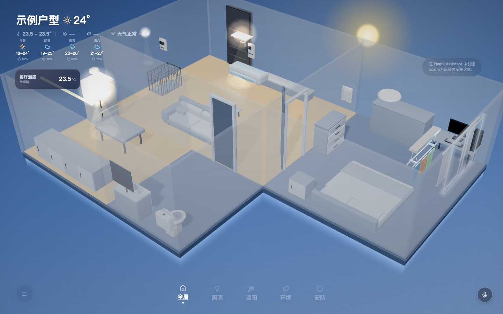
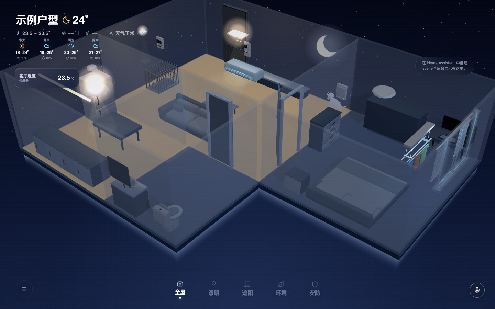
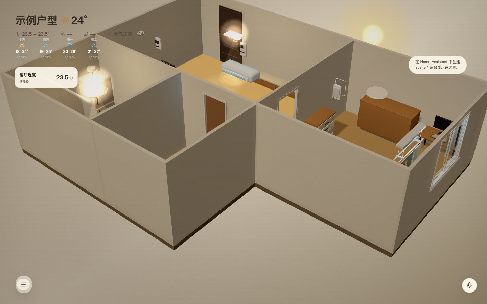
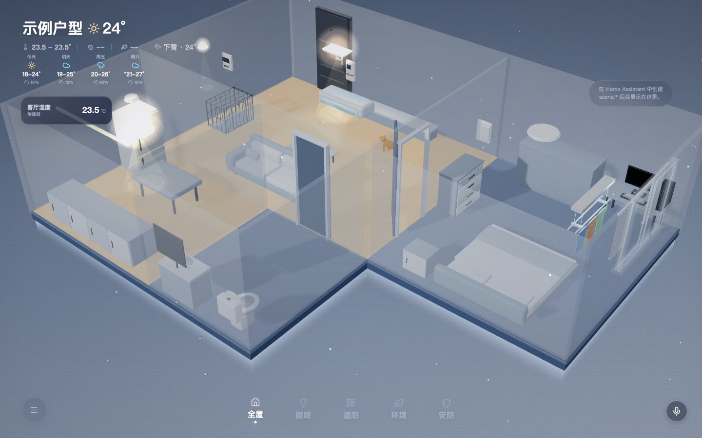
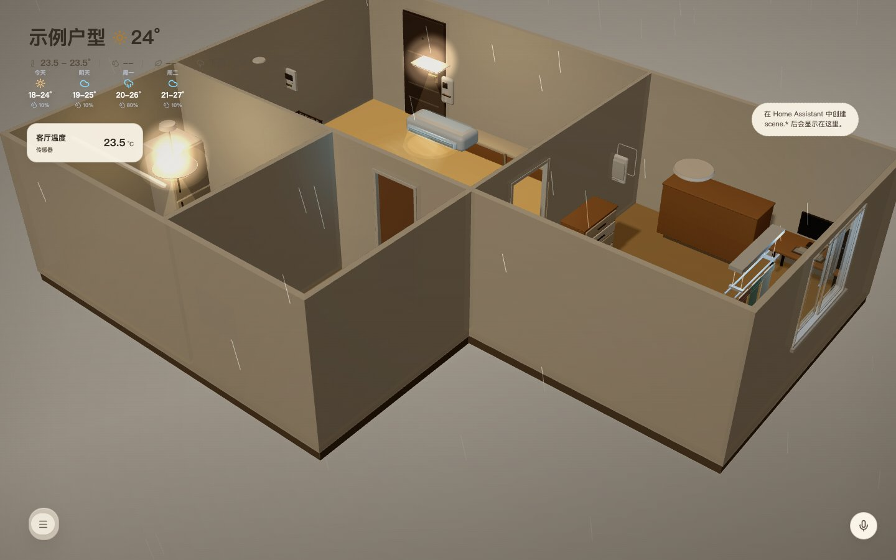
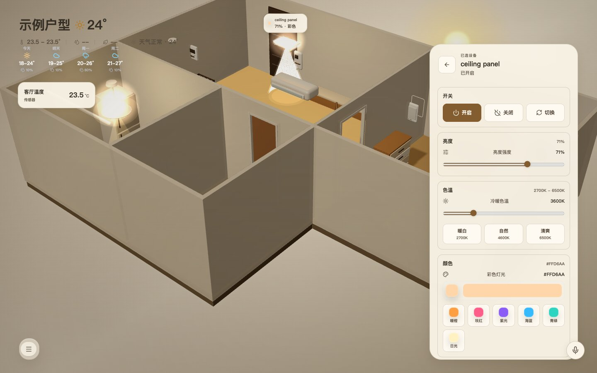
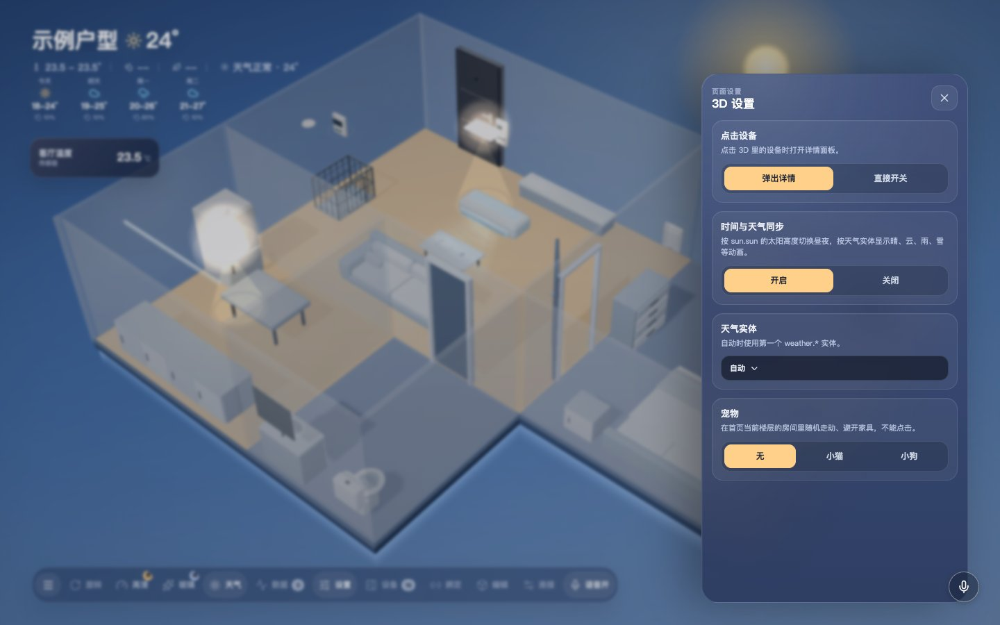
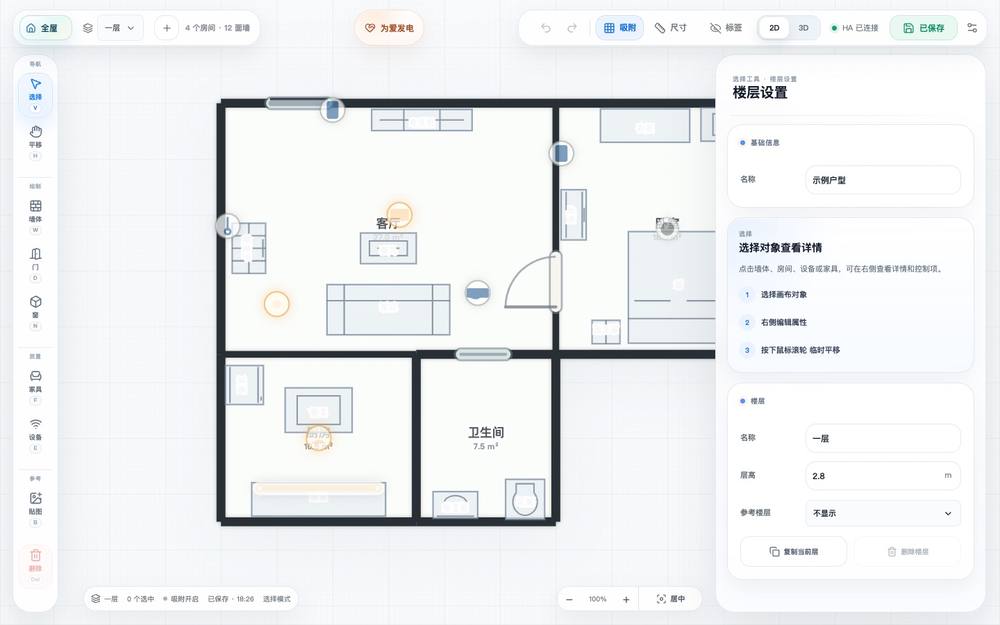
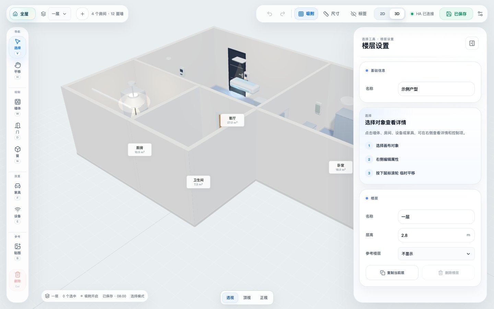
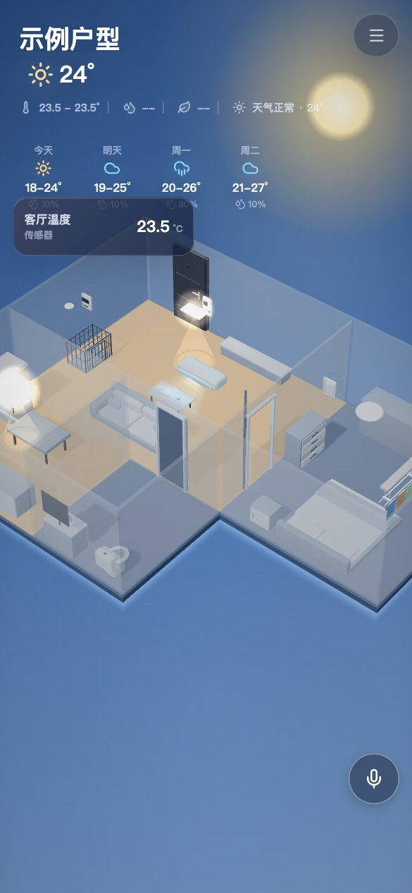

# JMGLink HA 3D Home

Home Assistant 的 3D 户型可视化与控制中心。在 HA 侧边栏里用 3D 户型图查看全屋设备状态，点一下就能控制；环境跟随真实的时间和天气变化。户型、家具、门窗和设备点位都在内置编辑器里画出来，并绑定到 HA 实体。

> 截图使用仓库自带的示例户型和模拟的 HA 数据。

## 功能

### 3D 首页

- 整屋 3D 户型：墙体、房间、门窗、家具和设备按编辑器里的布局渲染，支持多楼层切换、按房间聚焦。聚焦房间时显示这个房间的状态汇总：第一行是温湿度（多个传感器时取最低值），后面是灯、开关、空调、窗帘、门窗、门锁各开了几个，以及离线设备数。
- 设备状态实时显示：灯亮灭、窗帘和晾衣架开合、空调出风、门磁开合、传感器读数都会直接画在模型上，状态由 HA WebSocket 实时推送。
- 两种风格：「玻璃」（半透明墙体）和「奶油」（暖色实体墙）。
- 四档画质：高清、均衡、流畅、省电。没选过时按设备性能自动选择；省电、流畅档限帧，后台标签页暂停渲染，适合平板常亮挂墙。
- 顶部概览：天气、未来几天预报、温湿度和空气质量，概览里的数据可以自己选实体，也可以添加自定义数据卡片。
- ☰ 菜单里的「设备」面板列出全部设备，可以按 HA 区域筛选和搜索；右上角的场景面板可以直接触发 HA 场景。

| 夜晚 | 奶油风格 |
| --- | --- |
|  |  |

### 时间与天气同步

- 按 `sun.sun` 的太阳高度切换黎明、白天、黄昏、夜晚，主光源跟着太阳方位移动；没有 `sun.sun` 时按本机时间。
- 按天气实体显示晴天的太阳、夜晚的月亮和星空、多云、雨、雪、风、雾、雷暴等动画，天空颜色随昼夜和天气变化。
- 可以在「3D 设置」里关闭同步，或者指定使用哪个天气实体。

| 下雪 | 下雨 |
| --- | --- |
|  |  |

### 设备控制

- 点击 3D 里的设备有两种方式，在「3D 设置」里切换：
  - 弹出详情：打开右侧详情面板，可以调亮度、色温、颜色、窗帘位置、空调模式等。
  - 直接开关：灯、开关、风扇、窗帘点一下就切换，不弹窗；门锁、空调、传感器仍然弹出详情。
- 灯具开灯时自身发光，一眼能看出哪些灯开着；一个开关可以对应多个灯具模型，没有智能灯的普通灯也能显示。
- 支持的设备类型：灯（吸顶灯、筒灯、吊灯、灯带、彩色灯）、开关（含「电脑」样式）、窗帘和百叶（含「晾衣架」样式）、空调、风扇、门锁、温湿度等传感器、门磁人体水浸等二值传感器、电视、摄像头。
- 家电样式：洗衣机、烘干机（可以上下叠放）、洗碗机、洗袜机、花洒，运行时有转筒、指示灯或水流动画。
- 电视开机时屏幕显示宠物大头照。

### 门窗

- 普通门和「入户门」两种样式，入户门是深色金属厚门扇，有拉手、猫眼和门槛。
- 门可以绑定门磁（`binary_sensor`），开门时 3D 门扇转开。
- 门可以同时绑定门锁（`lock`），门把手上方的锁牌显示状态：绿色已上锁、琥珀色未上锁、红色锁卡住、灰色未知或离线。锁牌只显示状态，不能在 3D 里开锁。门只绑了门锁、没绑门磁时，门锁未上锁时门扇打开，其他状态关闭。

### 家具与宠物

- 内置沙发、床、餐桌、书桌、衣柜、鞋柜、电视柜、冰箱、马桶、浴室柜、斗柜、狗笼子等家具模型，可以缩放和旋转。
- 可以选一只小猫或小狗，在当前楼层的房间里随机走动、穿过门、避开家具。

### 3D 设置

### 户型编辑器

- 2D 平面图里画墙体、房间、门窗，放置家具和设备，自动吸附、显示尺寸；可以导入户型图作为底图，标定比例尺后照着描。
- 3D 视图里实时预览，透视、顶视、正视三种视角。
- 右侧属性面板右上角可以收起，收起后点右上角的「属性」按钮展开，这台设备会记住收起状态。
- 设备绑定 HA 实体，支持水平旋转、缩放、选择模型样式；未知或离线状态的实体也能绑定。
- 多楼层：复制楼层、设置层高、显示参考楼层。
- 项目导出、导入为 JSON，并保留自动备份，可以一键恢复。

| 2D 平面图 | 3D 预览 |
| --- | --- |
|  |  |

### 多设备与触屏

- 风格、天气预报、概览数据、点击方式、宠物等首页设置保存在加载项里，在一台设备上修改后，其他打开着的页面不用刷新就会同步。画质和语音设置和设备有关，每台设备单独保存。
- 适配手机和 iPad：单指旋转，双指平移和缩放，双击后拖动也可以平移；3D 区域不会误触发文字选择、放大镜和 HA App 的返回手势。
- 右下角麦克风对接 HA 语音助手，可以键入或说出指令。语音输入需要用 HTTPS 地址打开 HA（例如 Nabu Casa 远程访问，或给 HA 配置 SSL 证书）。

## 安装

本项目以 Home Assistant 加载项的形式安装，需要 Home Assistant OS 或 Supervised 安装方式，支持 `aarch64` 和 `amd64`。

或者手动添加：

1. 打开 **设置 → 加载项 → 加载项商店**。
2. 点右上角 **⋮ → 仓库**，添加 `https://github.com/Kyle0820/JMGLink-ha-3d-home`。
3. 刷新加载项商店，找到「JMGLink HA 3D Home」并安装。安装时 HA 会在本机构建，大约需要 1–2 分钟。
4. 启动加载项，打开「在侧边栏显示」，然后点侧边栏的「3D Home」进入。

第一次进入后，点 ☰ 菜单里的「编辑」开始画户型、放置设备并绑定实体，保存后回到首页即可使用。

## 致谢

本项目基于 JMGLink 发布的 [JMGLink HA 3D Home](https://gitee.com/tuotuo4ever/jmglink-ha-3d-home) 加载项改进而来，代码在本仓库独立维护，维护说明见 [MAINTAINING.md](MAINTAINING.md)，更新记录见 [CHANGELOG](jmglink-ha-3d-home/CHANGELOG.md)。
